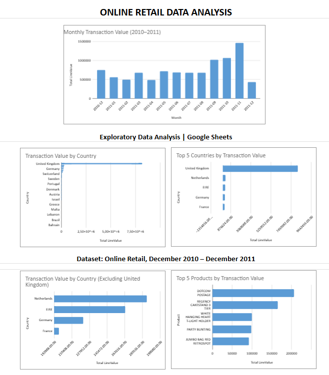

# Online Retail Data Analysis

## Project Overview
This project explores an online retail transaction dataset covering December 2010 to December 2011. The analysis was conducted in Google Sheets to identify transaction patterns, top-performing products, customers, and countries, while also investigating data quality issues.

## Tools
- Google Sheets
- Pivot tables
- Charts and dashboard visualisation

## Analysis Performed
- Created a calculated `LineValue` field using `Quantity × UnitPrice`.
- Investigated missing values, negative quantities, negative prices, and possible duplicate rows.
- Used pivot tables to summarize transaction value by month, product, customer, and country.
- Created a dashboard with charts highlighting monthly trends and the top five products, customers, and countries by transaction value.

## Key Findings
- **Monthly trend:** November 2011 had the highest monthly transaction value, approximately 1,461,756.25.
- **Products:** `DOTCOM POSTAGE` had the highest transaction value among product descriptions. This is a postage-related entry rather than a regular retail product.
- **Customers:** Customer `14646` had the highest transaction value among customers with an identified CustomerID.
- **Countries:** The United Kingdom had the highest transaction value.
- **Data quality:** 135,080 rows had a missing CustomerID, and 10,624 rows had a negative quantity.

## Data Quality and Limitations
The dataset contains missing CustomerIDs and descriptions, negative quantities, negative prices, and possible duplicate rows. These issues were investigated and documented, and the original data was preserved.

`LineValue` is calculated as `Quantity × UnitPrice`. It represents transaction value in this analysis and should not be interpreted as verified revenue or profit without further validation.

Product analysis includes postage-related entries, such as `DOTCOM POSTAGE`. Customer analysis is limited to records with an identified CustomerID.

## Skills Demonstrated
- Data quality checks
- Data cleaning and validation
- Calculated fields and formulas
- Pivot table analysis
- Data visualisation
- Dashboard creation
- Communicating analytical findings

  ## Dashboard

